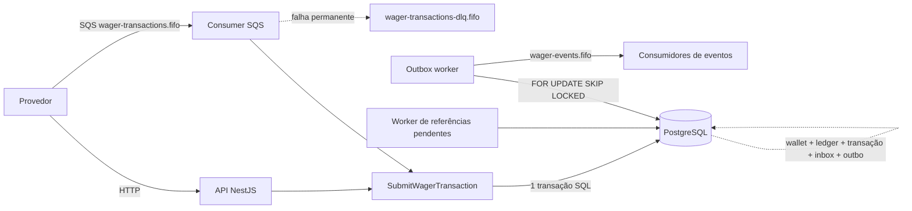

# Arquitetura

Este documento explica **por que** o sistema foi construído assim: as garantias, as decisões, os trade-offs e as limitações conhecidas. Para rodar o projeto, veja o [`README.md`](./README.md).

## 1. Visão geral

Há **um único use case** (`SubmitWagerTransaction`) para as duas entradas, HTTP e fila. Tudo o que muda dinheiro acontece dentro de **uma transação SQL**: saldo da wallet, transação, lançamento do ledger, registro de inbox (quando a entrada é SQS) e os eventos da outbox. Ou tudo confirma junto, ou nada.

Cada instância da aplicação roda a API e três workers (outbox, consumer SQS e referências pendentes). Não há coordenação entre instâncias fora do banco: a correção vem de locks, constraints e idempotência persistente.

## 2. Camadas e fronteiras

| Camada | Conteúdo | Regra |
| --- | --- | --- |
| `domain` | `Money`, `Wallet`, `WagerTransaction`, `WalletLedgerEntry`, `InboxMessage`, `OutboxMessage`, eventos | Puro: sem NestJS, sem ORM, sem decorators. Construtor privado e factories estáticas (`create`, `from`, `rehydrate`) |
| `application` | Use cases, **portas** (`ports/`), políticas (backoff, classificação de erros) | Depende só do domínio e de interfaces |
| `infrastructure` | Adaptadores MikroORM, SQS, workers, métricas, logger | Implementa as portas |
| `interface/http` | Controllers, DTOs, filtro de erros, health | Traduz HTTP para o use case |

Os use cases são classes puras, montadas por `useFactory` no `wagering.module.ts`. Assim os testes unitários não precisam do Nest, e trocar o ORM ou o broker é trocar um adaptador.

A reidratação a partir do banco usa `rehydrate`, que **não** revalida transições: só reconstrói um estado já persistido.

## 3. ORM, `Money` e estratégia transacional

**MikroORM com `EntitySchema`.** O domínio não tem decorators; cada agregado tem um `Record` (classe de dados) e um schema separados, ligados por *mappers* (`toDomain`, `toRecord`, `applyToRecord`). O custo é um mapeamento a mais por entidade; o ganho é um domínio que não conhece o ORM. Foi escolhido por expor o Unit of Work, o `EntityManager.transactional()` e o `LockMode` de forma explícita, o que ajuda a raciocinar sobre concorrência.

**`Money`.**
- Imutável; valor em `decimal.js` e moeda ISO de 3 letras maiúsculas.
- Entrada e saída são **string decimal** com escala fixa de 2 casas. Regex `^\d+(\.\d{1,2})?$`: rejeita `NaN`, `Infinity`, notação científica, vazio, mais de 2 casas, sinal e espaços.
- O DTO limita a 15 dígitos inteiros. Nenhum `number`, `float` ou `double` toca dinheiro.
- Na persistência: colunas `numeric(20,2)` mais uma coluna de moeda, reidratadas como `Money`.
- Operações entre moedas diferentes lançam erro de domínio (testado). O modelo é multi-moeda.

**Estratégia transacional.** Cada execução do use case roda em `em.fork().transactional(...)`: carrega e trava a wallet, aplica as regras no domínio, converte para records e faz o flush no commit. Se qualquer passo falhar, a transação é revertida inteira. Eventos só vão para a outbox **dentro** dessa mesma transação; nada é publicado antes do commit.

**Identificadores:** UUIDv7 (ordenáveis no tempo). `walletId` e `playerId` são validados como UUID.

## 4. Modelo de dados e constraints

As garantias abaixo vivem **no schema**, não apenas no código:

| Garantia | Mecanismo |
| --- | --- |
| Saldo nunca negativo | `CHECK (balance >= 0)` |
| Ledger imutável | Trigger bloqueia `UPDATE` e `DELETE` em `wallet_ledger_entries` |
| Sem exclusão de wallets e transações | Trigger bloqueia `DELETE` |
| Transação terminal não muda mais | Trigger impede alterar `PROCESSED`, `REJECTED` e `FAILED` |
| Saldo igual ao último lançamento | *Constraint trigger* **deferida**: no commit, o saldo da wallet precisa ser igual ao `balance_after` do último lançamento |
| Ordem estável do ledger | `wallet_version` único por wallet (também é o cursor da paginação) |
| Idempotência | `UNIQUE (provider_id, external_transaction_id)` e `UNIQUE (idempotency_key)` |
| Uma reversão por transação | Índice único parcial em `reference_transaction_id` para `REFUND` e `ROLLBACK` com status `PROCESSED` |
| Deduplicação de mensagens | `inbox_messages` com PK `(consumer_name, message_id)` |
| Uma wallet por jogador e moeda | Unicidade em `(player_id, currency)` |

`wager_transactions.wallet_id` **não** tem FK para `wallets`, de propósito: assim uma tentativa em wallet inexistente (`WALLET_NOT_FOUND`) continua gravada e auditável.

As migrations são versionadas e reversíveis (`migration:up` e `migration:down`, ambos testados).

## 5. Concorrência

A **unidade de concorrência é a wallet**. Não há lock global.

**Estratégia: lock pessimista por wallet.** A primeira operação da transação é `SELECT ... FOR UPDATE` na linha da wallet; só depois o sistema consulta idempotência, valida regras e grava. Duas apostas na mesma wallet se serializam; wallets diferentes correm em paralelo.

Por que pessimista e não otimista:
- Uma *hot wallet* (muitas apostas simultâneas) com otimista geraria uma tempestade de retries e conflitos. Com o lock, quem perde apenas espera.
- O raciocínio fica simples: dentro do lock, o saldo lido é o saldo vigente. Não existe `read → calculate → update` sem controle.
- O custo é a espera pelo lock, medida no histograma `wagering_wallet_lock_wait_seconds`.

**Ordem de locks sempre `wallet → transação → inbox`**, o que evita deadlock entre operações da mesma wallet. Quando a wallet não existe, não há linha a travar; o desempate fica com as constraints únicas.

**Corrida entre inserts.** Duas requisições com a mesma chave podem tentar inserir ao mesmo tempo. A perdedora recebe `UniqueViolationError`, a transação é revertida e o use case refaz a operação (até 5 vezes). Na segunda tentativa ela encontra a transação vencedora e responde como replay.

**Cenário obrigatório** (saldo 100, duas apostas de 80 simultâneas): uma `PROCESSED`, a outra `REJECTED` com `INSUFFICIENT_FUNDS`, saldo final 20.00, um único débito no ledger. É testado no nível do use case, da API HTTP e com processos separados.

## 6. Idempotência

- O header `Idempotency-Key` é obrigatório e é a fonte da verdade. O padrão recomendado é `{providerId}:{externalTransactionId}`.
- **`payloadHash`:** SHA-256 do **JSON canônico** (chaves ordenadas recursivamente, `undefined` omitido) dos campos de negócio: `providerId`, `externalTransactionId`, `playerId`, `walletId`, `roundId`, `gameId`, `kind`, `money` e `referenceExternalTransactionId`. O header e os metadados de transporte ficam **fora** do hash.
- Mesma chave e mesmo payload: devolve o **resultado original** (mesmo status HTTP e o saldo observado naquele momento) com `idempotentReplay: true`.
- Mesma chave e payload diferente: `409` com `PAYLOAD_MISMATCH`. Mesmo `externalTransactionId` com outra chave: `409` com `DUPLICATE_EXTERNAL_TRANSACTION`.
- **Rejeições também são gravadas**, para auditoria e para o replay devolver o mesmo `422`. O saldo observado na decisão fica em `observed_balance`; é `null` quando a wallet não existe ou pertence a outro jogador, para nunca vazar saldo.
- Nenhum cache em memória participa da idempotência.

## 7. Regras de negócio e interpretações

| Tipo | Efeito | Ledger | Observações |
| --- | --- | --- | --- |
| `BET` | Débito | `DEBIT` | Sem referência; rejeitada se faltar saldo |
| `WIN` | Crédito | `CREDIT` | Referência opcional |
| `LOSS` | Nenhum | Nenhum | Aceita valor `0.00`; gera o evento `Processed`, não gera `WalletBalanceChanged` |
| `REFUND` | Crédito | `CREDIT` | Referencia uma `BET`, mesmo valor |
| `ROLLBACK` | Inverso da referência | Direção invertida | Referencia `BET`, `WIN` ou `REFUND`, mesmo valor |

`OPENING` é interno: a API e a fila o recusam com `400`.

**Interpretações adotadas** (o enunciado deixa margem):
1. **Uma única reversão processada por transação referenciada, de qualquer tipo.** O enunciado diz "pelo mesmo tipo de operação"; adotamos a leitura mais conservadora: se uma `BET` já foi revertida por `REFUND`, um `ROLLBACK` da mesma `BET` também é recusado (`ALREADY_REVERSED`). Evita reverter duas vezes o mesmo valor por caminhos diferentes. É garantido pelo índice único parcial.
2. **`ROLLBACK` que deixaria o saldo negativo** é `REVERSAL_WOULD_OVERDRAW`, código distinto de `INSUFFICIENT_FUNDS`, porque a causa operacional é outra.
3. **Referência de outro jogador, wallet, moeda, rodada ou provedor** é `REFERENCE_MISMATCH`.

### Taxonomia de `failureCode`

Todas as rejeições respondem `422` com um `failureCode` estável. A última coluna é a ação sugerida ao provedor.

| `failureCode` | Significado | Ação sugerida ao provedor |
| --- | --- | --- |
| `INSUFFICIENT_FUNDS` | Saldo insuficiente para a `BET` | Não reenviar igual; só nova tentativa (novo id) depois de saldo |
| `REVERSAL_WOULD_OVERDRAW` | A reversão deixaria saldo negativo | Não reenviar; tratar manualmente |
| `REFERENCE_NOT_FOUND` | A referência não chegou dentro do limite de tentativas | Enviar a referência e reenviar a reversão com novo id |
| `REFERENCE_NOT_PROCESSED` | A referência existe, mas foi rejeitada | Desistir: não há o que reverter |
| `REFERENCE_MISMATCH` | Provedor, jogador, wallet, moeda ou rodada divergem da referência | Corrigir o payload |
| `INVALID_REFERENCE_KIND` | Tipo de referência não aceito para esta operação | Corrigir o payload |
| `AMOUNT_MISMATCH` | Valor diferente do da referência | Corrigir o payload |
| `ALREADY_REVERSED` | A referência já foi revertida | Desistir: já está revertida |
| `WALLET_NOT_FOUND` | Wallet inexistente | Corrigir o `walletId` |
| `PLAYER_WALLET_MISMATCH` | A wallet pertence a outro jogador | Corrigir o payload |
| `CURRENCY_MISMATCH` | Moeda diferente da moeda da wallet | Corrigir o payload |
| `INTERNAL_ERROR` | Erro permanente de infraestrutura (`FAILED`, auditável) | Contatar a operação |

### Status HTTP

| Situação | Status |
| --- | --- |
| `PROCESSED` | `200` |
| `REJECTED` por regra de negócio | `422` |
| `PENDING` e `PENDING_REFERENCE` (aceita, resultado pendente) | `202` |
| Payload ou parâmetro inválido | `400` |
| `IDEMPOTENCY_CONFLICT` e `WALLET_ALREADY_EXISTS` | `409` |
| Recurso não encontrado | `404` |
| Falha transitória de infraestrutura | `503` com `Retry-After` |
| Erro inesperado | `500` (nunca vaza detalhe interno) |

O mapeamento é o mesmo em todos os endpoints. O provedor decide pelo status se pode reenviar: `4xx` com `failureCode` não se reenvia igual; `503` sim, depois do `Retry-After`; `202` consulta depois. O replay devolve o status original, e `GET` devolve `200` mesmo para uma transação `REJECTED` (a consulta teve sucesso; o resultado está no corpo).

## 8. Referências fora de ordem (`PENDING_REFERENCE`)

Um `REFUND` ou `ROLLBACK` cuja referência ainda não existe é gravado como `PENDING_REFERENCE` (resposta `202`, saldo intocado, evento `WagerTransactionPendingReference`).

Um worker por instância (polling de 1 s) reavalia as pendentes com **backoff exponencial**: até **10 avaliações**, espera de 2 s dobrando até o teto de 60 s (cerca de 5 minutos no total). Esgotado o limite, a transação vira `REJECTED` com `REFERENCE_NOT_FOUND` e o evento `Rejected` é publicado. Um replay depois da resolução devolve o estado final.

Por que ~5 minutos: provedores que enviam fora de ordem costumam corrigir em segundos; esperar mais deixaria o provedor sem resposta definitiva por muito tempo. O valor é uma constante fácil de ajustar. Várias instâncias disputando a mesma pendente são seguras: o lock da wallet garante que a resolução aconteça uma única vez (testado com 4 e 5 workers).

## 9. Transactional outbox

Eventos: `WagerTransactionProcessed` (inclusive `LOSS`), `WagerTransactionRejected`, `WalletBalanceChanged` (**somente** quando o saldo muda) e `WagerTransactionPendingReference`. `OPENING` e replays não geram evento.

Cada evento é uma subclasse de `IntegrationEvent`, com `eventType` e `version` no tipo. O payload é o envelope JSON (`eventId`, `eventType`, `aggregateId`, `correlationId`, `causationId`, `occurredAt`, `version`, `data`); `data` carrega `MoneyProps` (string decimal), nunca a instância de `Money`.

**Publisher:**
- Lote de 20 com `SELECT ... FOR UPDATE SKIP LOCKED`: vários publishers concorrentes nunca pegam a mesma linha.
- **At-least-once.** Se o processo morre depois de publicar e antes do commit do lote, outra instância publica de novo. O `eventId` (o id da outbox) é a chave de deduplicação do consumidor, e a FIFO também deduplica por `MessageDeduplicationId = eventId` (otimização, não garantia).
- Falha do broker: a mensagem fica pendente com backoff de 1 s a 60 s, **sem ser descartada**.
- `MessageGroupId` é a wallet (`data.walletId`).
- **Fila de saída separada** (`wager-events.fifo`): se os eventos fossem para a fila de entrada, o consumer leria os próprios eventos como pedidos de transação.

O `correlationId` vem do header `X-Correlation-Id` ou é gerado; para mensagens SQS sem `correlationId`, usa-se o `messageId`; no worker de pendentes, é o id da transação. O `causationId` do `WalletBalanceChanged` aponta para o `eventId` do `Processed`.

## 10. Consumer SQS

O consumer (`WagerMessageConsumer`) não conhece o SQS: depende da porta `WagerQueue`. O adaptador `SqsWagerQueue` faz o `ReceiveMessage` com long polling, `DeleteMessage`, `ChangeMessageVisibility` e o envio à DLQ.

**Inbox na mesma transação SQL.** O `SubmitWagerTransaction` recebe `inbox: { consumerName, messageId }` e, dentro da transação, na ordem: **trava a wallet → consulta o inbox → consulta a idempotência → regras → grava**. O inbox vem antes da idempotência porque só ele impede que o mesmo `messageId`, chegando com outra `Idempotency-Key`, seja processado como transação nova. Mesmo `messageId` com hash diferente é conflito permanente. O registro de inbox é gravado junto com o efeito financeiro, já com `processed_at` preenchido (recebido e processado confirmam no mesmo commit).

**Decisão de cada mensagem** (pura, testada sem SQS):

| Resultado | Ação |
| --- | --- |
| Processada, `REJECTED`, `PENDING_REFERENCE` ou replay | `ack` **depois** do commit |
| Erro transitório (conexão, deadlock, serialização, corrida de unicidade) ou erro inesperado | Sem `ack`; volta com backoff de 2 s dobrando até 60 s |
| Erro permanente (JSON inválido, tipo desconhecido, dado recusado pelo domínio, conflito de idempotência ou de inbox) | Envio imediato à DLQ com `deadLetterReason`, `deadLetterDetail` e `receiveCount` nos atributos; depois `delete` |
| Esgotadas as 5 tentativas | DLQ com `MAX_ATTEMPTS_EXCEEDED` |

A DLQ explícita (em vez de só esperar o redrive da SQS) registra o **motivo** e evita gastar 5 tentativas num erro que nunca passa. O redrive configurado na fila (`maxReceiveCount` 5) continua como rede de segurança.

**Ordem e paralelismo.** Mensagens da mesma carteira são processadas em ordem; carteiras diferentes em paralelo (limite de 5). Se uma mensagem não conclui, as seguintes da mesma carteira no lote voltam à fila na hora, para que nenhuma passe na frente.

**Shutdown (`SIGTERM`).** Em duas fases: `stop()` aborta o long polling e a mensagem em andamento termina (commit e ack); as que ainda não começaram são devolvidas com visibilidade 0. O hook roda antes do fechamento do ORM, então o commit em andamento conclui.

**Falha entre commit e ack** (processo morre depois do commit): a mensagem volta depois do timeout de visibilidade, o inbox a reconhece e ela recebe o ack sem novo efeito (testado).

## 11. Observabilidade

- **Logs estruturados em JSON**, uma linha por evento, com `correlationId`, `messageId`, `transactionId`, `walletId` e `providerId`. Há uma linha `transaction_decided` por decisão e linhas para DLQ, retry e falhas de ack. Não são logados valores financeiros nem payloads completos.
- **Métricas** (Prometheus, `GET /metrics`): transações por status e tipo, duplicatas (`replay`, `payload_mismatch`, `duplicate_external_transaction`, `inbox_payload_mismatch`), retries por componente, mensagens em DLQ por motivo, conflitos de lock (corrida de unicidade, deadlock, serialização), tempo de espera pelo lock da wallet, latência de processamento, desfecho das pendentes de referência e o **lag da outbox** (pendentes e idade da mais antiga, lidos do banco na hora do scrape).
- As métricas são chamadas **depois do commit**, nunca dentro da transação; se fossem, uma transação refeita por corrida contaria em dobro.
- **Health:** `/health/live` (processo) e `/health/ready` (PostgreSQL e as três filas).
- A **reconciliação** (`POST /wallets/:id/reconciliation`) compara em uma consulta o saldo guardado com a soma do ledger e devolve a diferença. Divergência é logada como erro e sinalizada na resposta; **nunca é corrigida silenciosamente**.

## 12. Autenticação

**Decisão: não implementada**, como o enunciado permite (não vale pontos e não deve competir com correção, concorrência e idempotência). O ponto de extensão está explícito no código: um `NoopAuthGuard` nos controllers, que é onde o guard real entraria.

**Desenho que seria adotado:**
- Um Identity Provider externo (**Keycloak** ou **Zitadel**), sem tabela própria de usuários nem hash de senha na aplicação.
- Cada provedor de jogos é um *client* OIDC e obtém tokens pelo fluxo `client_credentials`.
- Um `AuthGuard` valida o JWT (assinatura via JWKS, `issuer`, `audience`, expiração) e extrai a identidade. Uma porta (`ProviderIdentityPort`) resolveria o `providerId` a partir das claims.
- O `providerId` do token precisa coincidir com o do payload (`403` em caso contrário), e escopos separariam submissão (`wagering:submit`) e consulta (`wallets:read`).
- Health (e as métricas, em produção, restritas por rede) ficam abertos.
- Mensagens da fila são um canal interno confiável, protegido por permissões de IAM da fila; a identidade do provedor contida na mensagem continua sujeita às mesmas validações de domínio.

## 13. Testes e invariante

A pirâmide: testes unitários rápidos para o domínio e as regras de decisão; testes de integração com **PostgreSQL e SQS reais** (sem mocks) para constraints, atomicidade, inbox, outbox, DLQ e concorrência; e um teste com **três processos reais** da aplicação compilada (`multi-instance.integration.spec.ts`) que cobre a carteira quente entre instâncias, a mesma aposta 60 vezes espalhada pelas instâncias, o consumo da fila por três instâncias e a morte abrupta de uma instância seguida de reinício.

A **invariante final** de todos os cenários de concorrência é `saldo da wallet == saldo reconstruído pelo ledger`, calculada a partir do próprio ledger. O banco a reforça no commit com a constraint trigger deferida.

## 14. Limitações conhecidas

| Limitação | Impacto | Como evoluir |
| --- | --- | --- |
| **Transação "venenosa" no worker de pendentes**: se a resolução de uma transação falha sempre, ela é retentada a cada rodada | Gasta ciclos, mas não bloqueia as demais (erro isolado por transação e reportado) | Contador de falhas por transação e quarentena |
| **Polling** (500 ms na outbox, 1 s nas pendentes) em vez de notificação | Latência de até um intervalo | `LISTEN/NOTIFY` ou CDC |
| **A transação do lote da outbox fica aberta durante o envio ao SQS** | Com o SQS lento, as linhas do lote ficam travadas para outros publishers (nunca para o fluxo financeiro) | Reservar o lote, publicar fora da transação e confirmar depois |
| **Ordem dos eventos por carteira é best-effort entre publishers concorrentes** | Um publisher pode publicar a mensagem 2 antes da 1 | Consumidores usam `walletVersion` (em `WalletBalanceChanged`) para reordenar ou ignorar eventos antigos |
| **Visibility timeout fixo de 30 s** no consumer | Uma transação presa mais que isso (carteira muito disputada) pode ser entregue de novo enquanto roda; o lock e o inbox mantêm a correção, mas há trabalho repetido | Estender a visibilidade durante o processamento |
| **Carteira bloqueada durante o retry**: uma mensagem em backoff segura as seguintes da mesma carteira | No pior caso, cerca de 30 s (2+4+8+16) antes da DLQ | Reduzir o limite de tentativas ou classificar mais erros como permanentes |
| **DLQ pode receber duplicata** se o envio funcionar e o `delete` da fila principal falhar | Deduplicada por 5 minutos pelo `MessageDeduplicationId`; depois disso pode aparecer duas vezes | Consumidor da DLQ idempotente |
| **Métricas por processo**; contadores zeram no reinício | Cada instância expõe as suas | O coletor (Prometheus) soma as instâncias |
| **Lag da outbox faz uma consulta por scrape** | Com muitas pendentes, o custo cresce | Índice parcial em `published_at IS NULL` |
| **Reconciliação só reporta** | Divergência exige ação humana | Fluxo de correção auditado, fora do escopo |
| **Sem autenticação** (seção 12) | API aberta | Guard OIDC descrito acima |
| **Sem ledger de partidas dobradas e sem teste de carga** | Diferenciais opcionais, não implementados | — |
| **No Windows o kill dos testes é abrupto** | O `SIGTERM` gracioso não é exercitado nos testes de processos (o shutdown limpo é coberto nos testes do consumer) | Rodar a suíte em Linux/CI |
